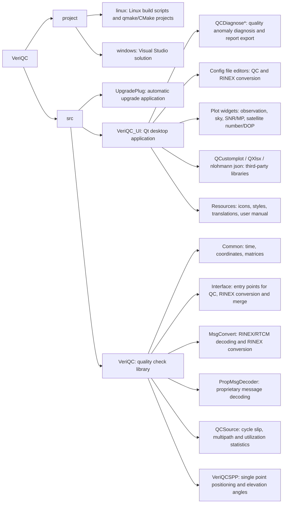

VeriQC
=========

[](#)

[![Release][release-image]][releases]
[![License][license-image]][license]

[release-image]: https://img.shields.io/github/release/chcnav-gnss/VeriQC
[releases]: https://github.com/chcnav-gnss/VeriQC/releases

[license-image]: https://img.shields.io/github/license/chcnav-gnss/VeriQC.svg
[license]: https://github.com/chcnav-gnss/VeriQC/blob/main/LICENSE

VeriQC is a post-processing quality inspection and analysis tool for GNSS observation data. It evaluates the quality of observation files at the epoch, satellite and frequency level, and presents the results through interactive charts, HTML reports and Excel summaries. Typical users are surveyors, researchers, system integrators and anyone who needs dependable GNSS data quality assessment before using the data for positioning or analysis.

## Key Features

### Data quality inspection
- Cycle slip detection
- Pseudorange multipath (MP) estimation
- Signal-to-noise ratio (SNR) statistics and threshold checks
- Data availability / utilization rate
- Satellite visibility and DOP
- Zero-baseline, short-baseline and triple-difference epoch QC modes
- Elevation mask, per-system and per-frequency configuration

### Visualization
- Observation time-series plots
- Sky plot with per-system satellite colors
- Satellite number and DOP plots
- SNR and multipath plots
- Compact layout for the observation sequence plot

### QC diagnosis
- Data import error prompts, resolved down to the affected system
- Quality anomaly diagnosis from four dimensions: cycle slip, SNR, multipath and data availability
- Human-readable diagnosis text and exportable diagnosis report

### Configuration and batch processing
- Built-in editors for the QC configuration file and the RINEX conversion configuration file
- Custom configuration files for command-line batch processing
- `VeriQC_Console.exe` for batch quality inspection or RINEX conversion of all data under an input directory (`VeriQC_Console.exe -h` for usage)
- Ephemeris modes: automatic same-name lookup, no ephemeris, specified file

### Data conversion and output
- RINEX conversion and RINEX file merging
- RTCM data time auto-detection and time-segment splitting
- HTML QC reports, Excel summaries and binary QC result files

## Supported input formats
- RINEX observation files
- RTCM 2 / RTCM 3
- RawMsg ASCII and RawMsg Binary
- CHC RawMsg Binary
- HRC / HRCX
- XW1 (SatNet LEO)

## Architecture



## Algorithm overview

*   General process
  
  [](#)
*   Multipath
  
  [](#)
*   Cycle slip
  
  [](#)

## Build from source

VeriQC depends on Qt 5.12.12. Install it before compiling.

### Windows
- Install [Qt 5.12.12](https://download.qt.io/archive/qt/5.12/5.12.12/) with the Qt Online Installer.
- Install the latest [Visual Studio](https://visualstudio.microsoft.com/).
- Clone the repository: `git clone https://github.com/chcnav-gnss/VeriQC.git`
- Open `project/windows/VeriQC_UI.sln` in Visual Studio, make sure the Qt version is selected correctly, then choose `Build Solution`.

### Linux
```bash
sudo apt install build-essential cmake linuxdeployqt
git clone https://github.com/chcnav-gnss/VeriQC.git
cd VeriQC/project/linux
./build.sh
./deploy.sh
```

## Configuration
Example configuration files are provided in `src/VeriQC/doc/`:
- `GNSSConfig.txt` — QC parameters, thresholds and input/output settings
- `RinexConfig.txt` — RINEX conversion settings

The same parameters can be edited from the application under Settings → QC Settings and Settings → RINEX Convert Settings.

## Release notes
See [doc/releaseNote_en.txt](doc/releaseNote_en.txt) for the full change history. The latest version is V1.0.17.0.

## Feedback & Contribution
Feedback, bug reports and contributions are welcome. Please open an Issue or submit a Pull Request.
